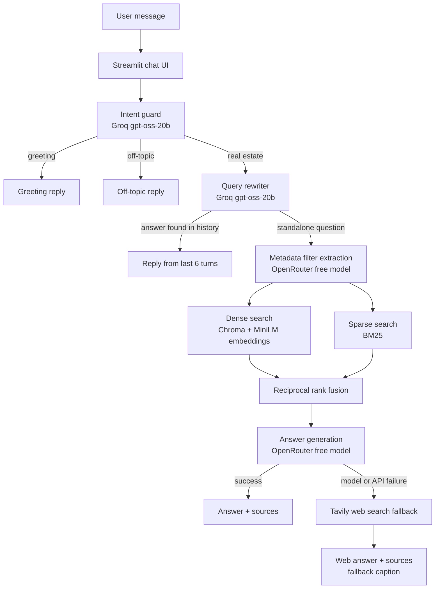

# AI Real Estate Assistant

A Streamlit chatbot for real estate questions, built with hybrid retrieval
(BM25 + Chroma vector search), metadata filters, an intent guard, query
rewriting, and a Tavily web-search fallback.

## Features

- Bilingual chat (Arabic and English) with conversation memory.
- Metadata filtering by city, district, country, project, unit type, purpose,
  and price range. Language is intentionally not filtered.
- Intent guard: greetings and off-topic messages are answered without retrieval.
- Query rewriting: follow-ups like "what about Riyadh?" become standalone
  questions; questions already answered in the chat are answered from history.
- Hybrid retrieval with reciprocal rank fusion over a persisted Chroma store.
- Tavily fallback when the model APIs are unavailable.

## Architecture



### Request lifecycle

1. **Intent guard** classifies the message as `greeting`, `real_estate`, or
   `off_topic`. Greetings and off-topic messages return immediately.
2. **Query rewriter** uses the last 6 Q&A turns to rewrite follow-ups into
   standalone questions, or answers directly when the history is sufficient.
   If there is no history, the question is used as-is.
3. **Metadata filter extraction** produces a Chroma `where` filter plus a Python
   predicate for BM25 results. `language` is never filtered.
4. **Hybrid retrieval** runs Chroma dense search with the metadata filter and
   BM25 sparse search with the predicate, then fuses both ranked lists with
   weighted reciprocal rank fusion.
5. **Answer generation** answers only from the retrieved context and returns the
   answer with its sources.

## Models and components

| Stage | Provider | Model / component | Config |
|---|---|---|---|
| Intent guard | Groq | `openai/gpt-oss-20b` | `REWRITE_MODEL` |
| Query rewriter | Groq | `openai/gpt-oss-20b` | `REWRITE_MODEL` |
| Metadata filters | OpenRouter | `inclusionai/ling-3.2-flash:free` | `MODEL_NAME` |
| Answer generation | OpenRouter | `inclusionai/ling-3.2-flash:free` | `MODEL_NAME` |
| Embeddings | Local | `sentence-transformers/paraphrase-multilingual-MiniLM-L12-v2` | `EMBEDDING_MODEL` |
| Sparse retrieval | Local | BM25 (`rank-bm25`) | `SPARSE_TOP_K` |
| Vector store | Local | Chroma (`chroma_db/`) | `PERSIST_DIR` |
| Web fallback | Tavily | Search + optional generated answer | `TAVILY_API_KEY` |

All model names and base URLs can be overridden through environment variables or
Streamlit secrets.

## Fallback behaviour

The Tavily fallback is triggered when the answer model call fails (rate limit,
timeout, outage, invalid key, etc.):

1. The pipeline catches the model error and logs a warning.
2. Tavily searches `wasalt.sa`, `darglobal.co.uk`, and `darglobal.com`. If that
   returns nothing, it retries across the open web.
3. Tavily's generated answer is used when available; otherwise the top results
   are formatted as bullet points.
4. Results are converted to LangChain `Document`s so the UI can show sources,
   and the response is marked with `fallback: tavily`. The chat shows the note
   "AI model unavailable — answered using live web search (Tavily)."
5. Brand names and domains are neutralised in the fallback answer and titles.

Other stages degrade gracefully instead of failing the request:

- Intent guard failure → continue as `real_estate`.
- Rewriter failure → use the original question.
- Filter extraction failure → continue with unfiltered retrieval.
- Tavily unavailable or failing → return a polite "try again later" message.

## Project structure

```text
app/app.py               Streamlit chat UI
pipeline/                Build and recommendation pipelines
src/                     Retrieval, filters, rewriter, intent guard, fallback
utils/                   LLM clients, logging, JSON helpers
config/config.py         Settings and secrets
data/chatbot_corpus.jsonl
chroma_db/               Persisted vector store (committed for deployment)
```

## Local setup

Python 3.12 is required.

```powershell
python -m venv .venv
.\.venv\Scripts\Activate.ps1
pip install -r requirements.txt
```

Create a `.env` file in the project root:

```text
OPENROUTER_API_KEY=...
GROQ_API_KEY=...
TAVILY_API_KEY=...
```

Build the vector store only if `chroma_db/` is missing or data changed:

```powershell
python pipeline/build_pipeline.py --overwrite
```

Run the app:

```powershell
streamlit run app/app.py
```

## Docker

The image uses the `ghcr.io/astral-sh/uv` Python 3.12 base, installs CPU-only
PyTorch, pre-downloads the embedding model, and includes `chroma_db/` and the
corpus. It honours a cloud-provided `PORT` and defaults to `8501`.

```powershell
docker build -t ai-real-estate-assistant .
docker run --rm -p 8501:8501 `
  -e OPENROUTER_API_KEY=... `
  -e GROQ_API_KEY=... `
  -e TAVILY_API_KEY=... `
  ai-real-estate-assistant
```

Open `http://localhost:8501`. On a platform that injects `PORT`, pass `-e PORT`
or let the platform set it; the container binds to `0.0.0.0`.

## Streamlit Cloud deployment

1. Push this repository to GitHub.
2. Create a new Streamlit app and set the main file to `app/app.py`.
3. Add the secrets in the app settings:

```toml
OPENROUTER_API_KEY = "..."
GROQ_API_KEY = "..."
TAVILY_API_KEY = "..."
```

Optional overrides: `MODEL_NAME`, `REWRITE_MODEL`, `OPENROUTER_BASE_URL`,
`EMBEDDING_MODEL`.

`config/config.py` reads values from environment variables first and then from
Streamlit secrets, so the same code works locally and on Streamlit Cloud.
